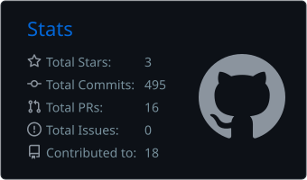
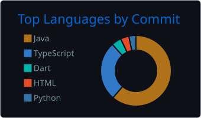

<h1 align="center">Hi, I'm Abdulrahman 👋</h1>

  <b>Full-Stack Software Engineer</b> · React · Node.js · Spring Boot · PostgreSQL
   
  I build secure, well-structured web platforms, from the database schema to the UI.

  
  
  
  

---

### About me

- 💼 **Full-Stack Engineer at eSkyIT**, building an enterprise IT Service Management platform with React, Node.js and PostgreSQL
- 🎓 **Teaching Assistant at Saxony Egypt University**, teaching Programming, IT and Computer Networks
- 🧱 I care about **clean architecture**, **access control done right** and **SQL that scales**
- 🎯 Open to **full-stack and backend roles**

### Tech stack

  
   
  
   
  

**Also:** JWT · Spring Security · JPA/Hibernate · Socket.IO · WebSockets · Swagger/OpenAPI · JUnit · Selenium · Flutter

---

### Featured projects

<table>
<tr>
<td width="50%" valign="top">

#### 🏢 Enterprise ITSM Platform
Private · Work project at eSkyIT

A multi-tenant IT Service Management platform covering incidents, service requests, SLA contracts, a knowledge base, file drive and live team chat.

- Role-based access control with **per-tenant data scoping**
- **Real-time** chat, read receipts and notifications over WebSockets
- **Clean Architecture** backend modules with hand-written SQL

`React` `Node.js` `Express` `PostgreSQL` `Socket.IO`

</td>
<td width="50%" valign="top">

#### 🏗️ OTTIMA
<a href="https://github.com/abdulrahmann12/ottima-backend">Backend</a> · <a href="https://github.com/abdulrahmann12/ottima-frontend">Frontend</a>

A platform for tracking construction finishing projects, with separate experiences for Admins, Engineers and Clients.

- **3-role** access with JWT + Spring Security
- **Live project status updates** over WebSocket
- Dockerized, with a consistent REST response format

`Java 21` `Spring Boot 3` `MySQL` `React` `Docker`

</td>
</tr>
<tr>
<td width="50%" valign="top">

#### 🔗 Blink
<a href="https://github.com/abdulrahmann12/Blink">Repository</a>

A URL shortener with an analytics platform built in.

- Custom aliases, password-protected and expiring links, QR codes
- Click analytics with **GeoIP** tracking
- **Redis** caching and **rate limiting** to protect the API

`Spring Boot` `MySQL` `Redis` `Docker`

</td>
<td width="50%" valign="top">

#### 📅 Uni-Guard Schedules
<a href="https://github.com/abdulrahmann12/uni-guard-schedules">Repository</a>

A full-stack system for scheduling university exams and assigning invigilators.

- Scheduling algorithms with **conflict detection**
- Automatic room allocation and role-based access
- Generated **PDF reports**

`Spring Boot` `React` `MySQL`

</td>
</tr>
</table>

---

### GitHub stats

  
  

Always learning, always shipping. Feel free to reach out 🤝

